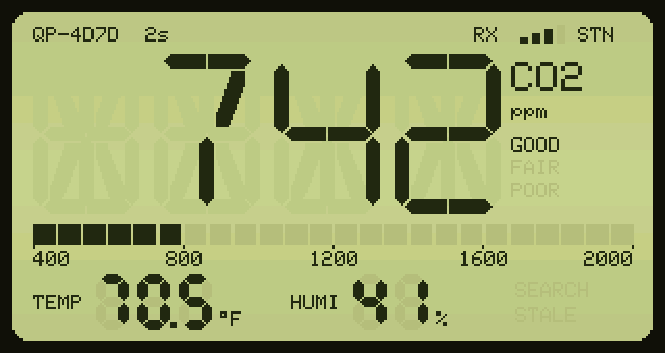
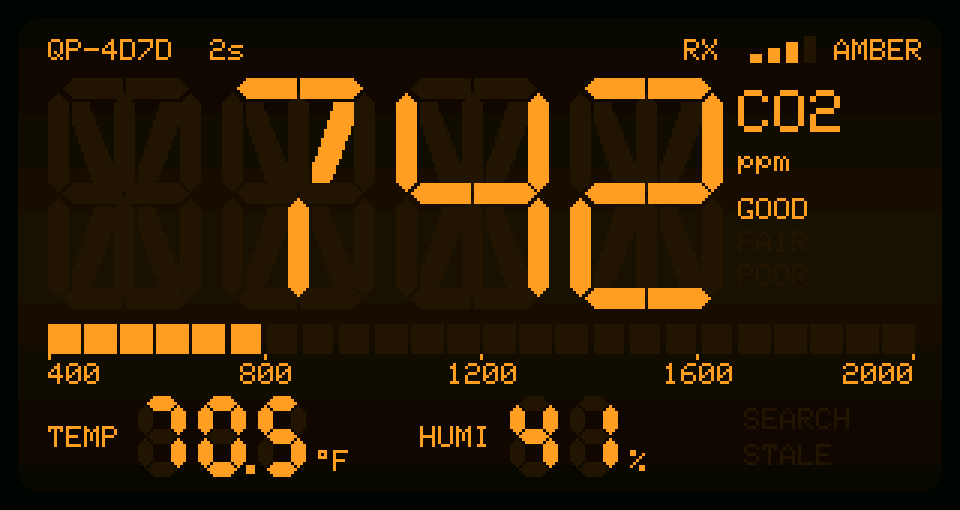
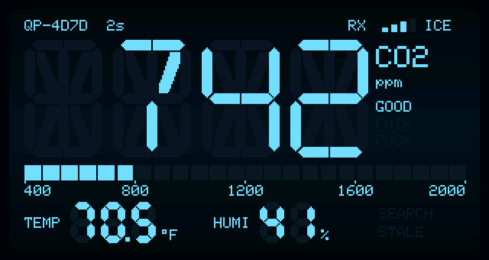
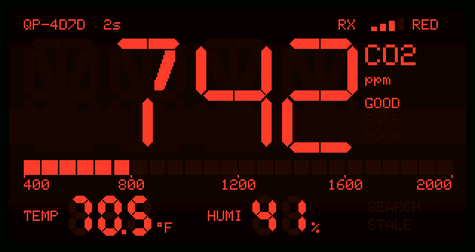
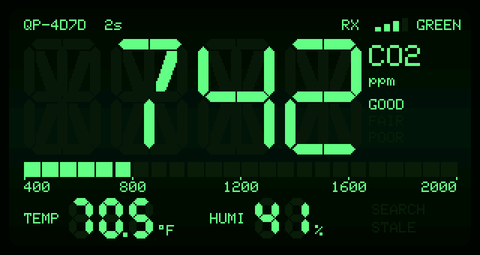

# qingping-co2-research

> [!CAUTION]
> **Everything in this repo, all code and all documentation, was vibe coded with an AI assistant.**
> It is published as a reference only: a record of one person's experiment with one unit. It has not been
> reviewed, audited or tested beyond "it worked on my desk". Expect mistakes. Don't rely on it for anything
> important, and use it at your own risk.

Custom firmware for a Qingping Air Monitor Lite (CGDN1) plus a desk display that shows its readings.



> [!WARNING]
> **Flashing this custom firmware is a one-way trip.** The stock firmware dump in this repo has been redacted
> (device-specific settings and factory data removed), so a unit **cannot be restored to factory** from it.
> Once you flash the custom firmware, expect the device to be unable to return to its original stock state.
> If you want a way back, dump your own unit's full flash first and keep it private.

```
Qingping (ESP32)  --BTHome v2 BLE advertisements-->  LilyGO T-Display-S3
SCD40 CO2/temp/RH                                    retro LCD-style readout
```

| Folder | Hardware | What it does |
|---|---|---|
| [`qingping-fw/`](qingping-fw) | Qingping Air Monitor Lite (ESP32-WROVER-B) | Reads the SCD40, broadcasts BTHome over BLE, shows CO2 level on the RGB LED. Wi-Fi stays off. |
| [`co2-display/`](co2-display) | LilyGO T-Display-S3 | Listens for the broadcasts and draws CO2, temperature (°F) and humidity. |
| [`stock-firmware/`](stock-firmware) | — | Redacted dump of the stock firmware, for reference only (not a restore image). |
| [`docs/PINOUT.md`](docs/PINOUT.md) | — | Qingping pinout recovered from the stock firmware and confirmed on hardware. |

Because the readings are standard [BTHome v2](https://bthome.io/) (unencrypted), Home Assistant's BTHome
integration also picks the monitor up automatically.

Both projects use PlatformIO (`espressif32`, Arduino core 3.x) and NimBLE-Arduino 1.4.3.

## Qingping firmware (`qingping-fw`)

### Normal mode
- Wi-Fi off; BLE advertises as `QP-XXXX` (last two MAC bytes) with BTHome packets: CO2 (ppm), temperature, humidity, packet id.
- SCD40 periodic measurement every 5 s.
- RGB LED: green < 800 ppm, yellow < 1200 ppm, red above. Blue until the first reading.
- Temperature is corrected for self-heating using the SCD40's built-in offset
  (`SCD40_TEMP_OFFSET_C` in `src/scd40.h`, currently 5.4 °C, calibrated against a reference thermometer).
  The sensor recomputes humidity from the corrected temperature.

### Configuration mode (OTA + Wi-Fi)
Hold the device button while powering on.

- Access point `QP-Setup-XXXX`, password `qingpingsetup`, web UI at http://192.168.4.1/ (or `http://qingping.local/`).
- Upload a new `firmware.bin` (OTA) and/or save home Wi-Fi credentials; once joined, the same UI is reachable on the home network.
- Exits after 10 minutes idle.

This is the way to update without opening the case.

### Building / flashing
```sh
cd qingping-fw
pio run                     # -> .pio/build/qingping/firmware.bin, upload it in configuration mode
pio run -t upload           # serial, see below
```

Serial flashing needs the case open: USB-serial adapter on the board's UART, and the board has **no auto-reset**,
so enter download mode by hand (hold IO0, tap EN, release IO0) before uploading. Port and flags are in
`platformio.ini`.

### Hardware quirks handled
- **Bad factory-MAC eFuse CRC** on this unit makes PHY/radio init abort. `src/efuse_mac_fix.cpp` wraps
  `esp_efuse_mac_get_default` (linker `--wrap`) to fall back to the raw factory MAC.
- Stale RF calibration from the stock firmware is erased from NVS in config mode (it caused Wi-Fi clients to drop).
- NimBLE on Arduino core 3.x needs `bleInUse()` overridden, or the core frees BLE controller memory at boot.
- GPIO12 is a strapping pin with an I2C pull-up; boots only because the VDD_SDIO eFuse forces 3.3 V. Don't change that.
- Running without the battery can brown out on SCD40 current spikes; keep the battery connected.

## Display firmware (`co2-display`)

- Passive BLE scan for names starting `QP-`; decodes BTHome v2.
- Late-90s monochrome LCD look: 16-segment CO2 digits with faint ghost segments, seven-segment temperature (°F)
  and humidity, a 400–2000 ppm bar graph, and RX / SEARCH / STALE / GOOD / FAIR / POOR annunciators.
- Double-buffered (`Arduino_Canvas`) so updates don't flicker.
- **GPIO14 button**: cycle colour themes (STN, amber, ice, red, green).
- **GPIO0 (BOOT) button**: flip the display 180°. Button roles swap with the flip so each action stays on the
  same physical side. Theme and orientation are saved to flash.
- Data is marked STALE after 30 s without a packet.

| AMBER | ICE |
|---|---|
|  |  |
| **RED** | **GREEN** |
|  |  |

The images are rendered on the host from the real `src/lcd_ui.cpp` (sample data, 3x scale):
`co2-display/tools/screenshot/build.sh` writes them to `docs/images/`.

```sh
cd co2-display
pio run -e tdisplay -t upload    # normal firmware
pio run -e preview -t upload     # glyph preview: buttons step the CO2 digits 0000..9999 and dashes
```

Upload port is set in `platformio.ini` (`/dev/cu.usbmodem21201`); adjust for your machine.

## Stock firmware (`stock-firmware`)

> [!WARNING]
> This dump is **redacted** and kept **for reference only**: it's the source the pinout and hardware notes were
> worked out from. It is not a restore image, and flashing it will not return a unit to its factory state.

Dumped from this unit (firmware `Sparrow_v1.0.2-264-g6c0ce49`) with esptool at 115200 baud.

| File | Contents | SHA-256 |
|---|---|---|
| `firmware.bin` | Full 4 MB flash image, redacted | `a888bee3…8cc721` |
| `app_ota0.bin` | Active app slot, extracted | `f61bb696…f99026` |
| `app_ota1.bin` | Inactive app slot, extracted | `446509e3…f6c4fe` |

In `firmware.bin` the `nvs` (0x9000, 16 KB), `test` (0x3d0000, 140 KB) and `factory_nvs` (0x3f3000, 16 KB)
partitions are erased to 0xFF. They held device-specific data: Wi-Fi credentials, cloud (MQTT) credentials,
HomeKit setup and pairing keys, BLE identity keys, RF calibration and stored history. Everything else, including the bootloader, partition table and both app slots, is as dumped.
